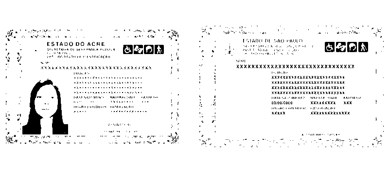
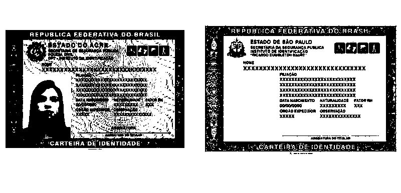
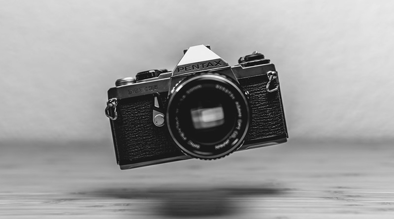
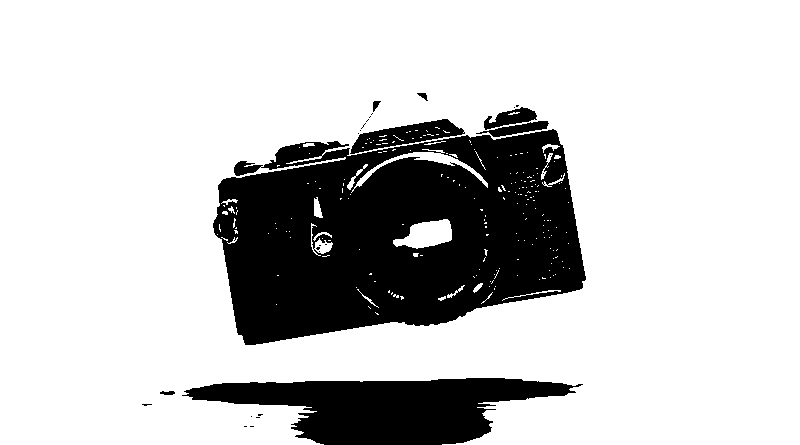

# Image Binarization with OpenCV


Comparison of four thresholding techniques on three photographs with very different
characteristics (a portrait, an object and an ID document). Built for the Digital Image
Processing course of the Computer Engineering program at UEA/EST.

| Grayscale input | Global threshold (127) | Otsu | Adaptive Gaussian |
|---|---|---|---|
|  |  |  |  |
|  |  |  |  |

## Pipeline

For each image in `images/`, [`binarize.py`](binarize.py):

1. Prints its technical properties (resolution, channels, color gamut).
2. Splits the R, G and B channels and plots a histogram for each one.
3. Converts it to grayscale.
4. Applies four binarization methods: fixed global threshold, Otsu, adaptive mean and
   adaptive Gaussian.

## Key findings

| Image | Fixed threshold | Otsu threshold | Takeaway |
|---|---|---|---|
| Portrait | 127 | 105 | Otsu lowers the threshold to separate the person from the background |
| Object | 127 | 117 | The fixed value was already close to optimal |
| ID document | 127 | 199 | A bright background needs a high threshold; the fixed one loses the text |

Under uneven lighting, adaptive thresholding is the only method that keeps detail in
shadowed regions.

## Getting started

```bash
pip install -r requirements.txt
python binarize.py   # reads images/ and writes everything to results/
```

## Project structure

```
├── binarize.py      # whole pipeline
├── images/          # input photos (the ID card is a public specimen)
├── results/         # generated channels, histograms, grayscale and binary images
└── docs/            # full report (PDF + Markdown) and per-image analysis, in Portuguese
```

## Documentation

- [`docs/report.pdf`](docs/report.pdf) / [`docs/report.md`](docs/report.md): full report
  with theoretical background, methodology and discussion (Portuguese).
- [`docs/results.md`](docs/results.md): tables and analysis for each image (Portuguese).

## License

[MIT](LICENSE)
