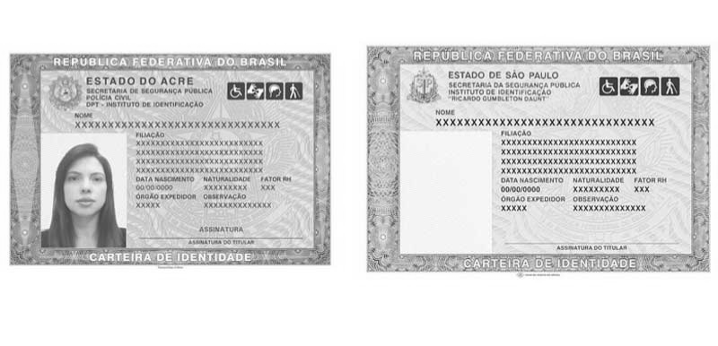
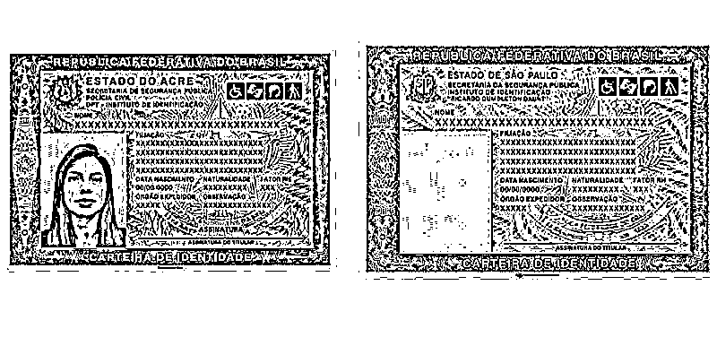
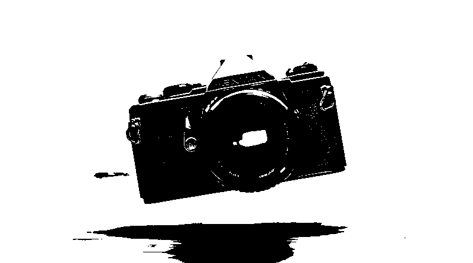
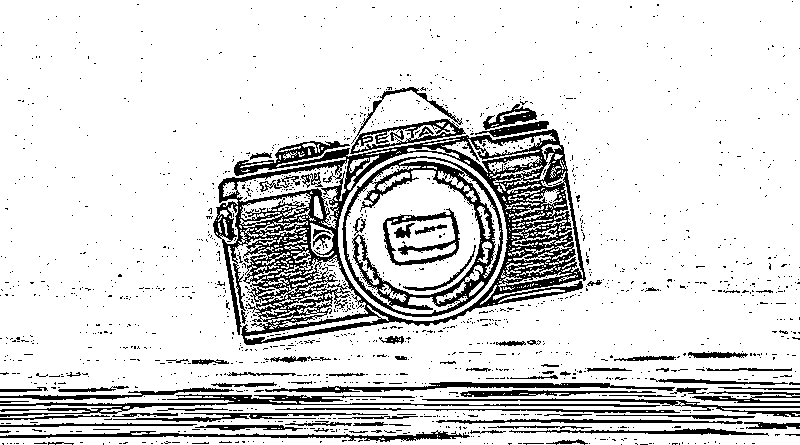

# Binarização de imagens com OpenCV

Comparação de técnicas de binarização sobre três fotografias com características diferentes
(pessoa, objeto e documento). Trabalho da disciplina de Processamento Digital de Imagens
(Engenharia da Computação, UEA/EST).

| Original (escala de cinza) | Limiar simples (127) | Otsu | Adaptativo gaussiano |
|---|---|---|---|
|  |  |  |  |
|  |  |  |  |

## O que o script faz

Para cada imagem em `fotos/`, `binarizacao_imagens.py`:

1. Mostra as características técnicas (resolução, canais, gamut).
2. Separa os canais R, G e B e gera o histograma de cada um.
3. Converte para escala de cinza.
4. Aplica quatro binarizações: limiar fixo, Otsu, adaptativa por média e adaptativa gaussiana.

## Resultado principal

| Imagem | Limiar fixo | Limiar de Otsu | Leitura |
|---|---|---|---|
| Pessoa | 127 | 105 | Otsu desce o limiar para separar a pessoa do fundo |
| Objeto | 127 | 117 | O limiar fixo já estava próximo do ideal |
| Documento | 127 | 199 | Fundo claro exige limiar alto; o fixo perde o texto |

Com iluminação irregular, o adaptativo é o único que preserva detalhe nas sombras.

## Como rodar

```sh
pip install -r requirements.txt
python binarizacao_imagens.py   # lê fotos/ e grava tudo em resultados/
```

## Documentação

- [`docs/relatorio.md`](docs/relatorio.md): relatório completo (referencial teórico,
  metodologia, discussão). Versão em PDF: [`docs/relatorio.pdf`](docs/relatorio.pdf).
- [`docs/resultados.md`](docs/resultados.md): tabelas e análise por imagem.

## Licença

[MIT](LICENSE)
